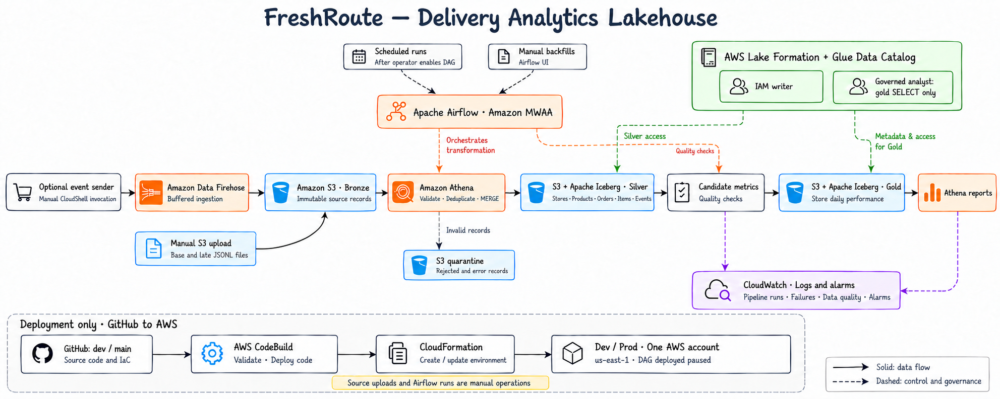
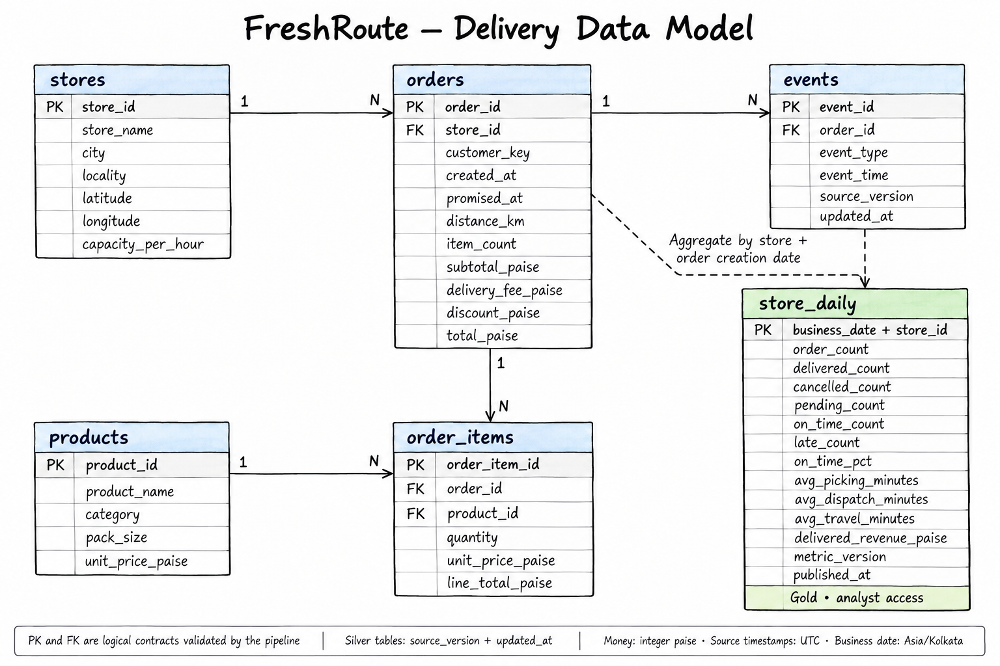

# FreshRoute — Grocery Delivery Analytics

An AWS data platform that explains delivery performance across grocery fulfillment stores and keeps historical reports accurate when data arrives late.

## Problem statement

A grocery delivery operation collects orders, basket items, and delivery updates separately. Missing delivery confirmations can make completed orders appear pending. Duplicate messages inflate counts, and invalid order amounts distort delivered order value.

Operations teams need reliable answers:

- Which stores are missing delivery promises?
- Is the delay happening during picking, dispatch, or travel?
- How many orders were delivered, cancelled, or remain pending?
- How should yesterday's report change when missing events arrive today?

## What we are building

FreshRoute combines these records into a governed lakehouse. It validates and deduplicates source data, reconstructs each order's lifecycle, and publishes **one performance record per store per business date**.

The report contains order counts, on-time percentage, stage durations, and delivered order value. New inputs and historical backfills use the same processing flow. Separate dev/prod resources run in one AWS account in **us-east-1**.

**Deployment and data operations are separate.** GitHub changes deploy infrastructure and application code. Operators upload existing source files in S3, enable processing in Airflow, and query results in Athena.

## Architecture



Manual file uploads land in S3 Bronze. An optional, independently invoked event sender can also deliver records through Firehose. Airflow coordinates Athena transformations into Silver Iceberg tables. Quality checks run on private candidate results before a single merge publishes Gold. Lake Formation controls analyst access to Gold.

| Component | What it does | Why it is included |
| --- | --- | --- |
| Grocery source files | Supply stores, products, orders, basket items, and events as plain JSONL. | Preserve inspectable inputs with reconciled business relationships. |
| Amazon Data Firehose | Buffers events sent by the optional manual sender into S3 files. | Provides a separate event-ingestion route when a producer supplies records. |
| Amazon S3 + Apache Iceberg | Retain original inputs and store current Silver records and Gold metrics. | Support replay, source corrections, and atomic table updates. |
| Amazon Athena | Validates, deduplicates, merges revisions, and calculates metrics. | Executes transformations and reporting SQL without a separate processing cluster. |
| Apache Airflow on Amazon MWAA | Schedules processing after an operator enables it and accepts manual backfills. | Manages dependencies, retries, and one active writer at a time. |
| Glue Data Catalog + Lake Formation | Define tables and govern analyst access to Gold. | Separate approved reporting from source and private processing data. |
| AWS CodeBuild + CloudFormation | Validate deployment code, provision resources, and publish Airflow code. | Deploy dev from `dev` and prod from `main`, independently of data loading. |
| Amazon CloudWatch | Stores operational logs and tracks processing failures and ingestion delays. | Makes failed runs and quality checks diagnosable. |

The five-minute schedule is a trigger interval; freshness also depends on ingestion and query execution. The design draws on the [published BigBasket lakehouse case study](https://aws.amazon.com/blogs/big-data/how-bigbasket-uses-the-iceberg-based-lakehouse-architecture-on-aws-to-power-lightning-fast-grocery-delivery-across-india/), with an independent schema and a smaller service footprint.

## Data model



`stores` and `products` describe the operation. `orders` captures basket amounts and delivery promises. `order_items` contains purchase-time quantities and prices. `events` records acceptance, picking, packing, dispatch, delivery, or cancellation. `store_daily` combines them into the reporting view.

Money is stored in integer paise and reported in INR. Source timestamps are UTC; business dates use `Asia/Kolkata`. On-time percentage uses delivered orders as its denominator and the actual delivery time, regardless of arrival time. Delivered order value includes fees and subtracts discounts; it is not accounting-recognized revenue.

## Included data and expected outcomes

The prepared files cover **7,000 valid orders, six stores, and 24 products over 1–7 October 2026**. Baskets, prices, quantities, discounts, and lifecycle times reconcile. Demand varies by time of day and affects fulfillment times. These are generated operational records, not private BigBasket transactions or live prices.

| File | Contents |
| --- | --- |
| `data/base/stores.jsonl` | Store locations and capacities. |
| `data/base/products.jsonl` | Grocery products, units, categories, and prices. |
| `data/base/orders.jsonl` | Order headers, including 42 invalid orders for quarantine. |
| `data/base/order_items.jsonl` | Basket quantities and line totals. |
| `data/base/events.jsonl` | Initial lifecycle events, including duplicate deliveries of messages. |
| `data/late/events.jsonl` | Delayed delivery confirmations with original business timestamps. |
| `data/manifest.json` | File checksums, record counts, and generation provenance. |
| `data/expected-default.json` | Independently reconciled expected business totals. |

Upload the five base files first, then the late-event file when ready to correct history. All inputs remain plain UTF-8 JSON Lines, with no archive extraction or data preparation required. CodeBuild never loads them.

| Outcome | After base files | After late events |
| --- | ---: | ---: |
| Valid orders | 7,000 | 7,000 |
| Delivered | 6,526 | 6,765 |
| Cancelled | 235 | 235 |
| Pending | 239 | 0 |

After all events, **3,473 deliveries are on time** and **3,292 are late**. Delivered order value is **₹2,863,493.80**. The Gold report contains 42 store/date rows, queryable through Athena and downloadable as CSV. Replays preserve these business totals.

## Processing and backfills

```text
S3 Bronze → plan inputs → merge Silver → build candidates → validate → publish Gold
```

The planner freezes each run's files. Valid records merge into Silver by business key and source revision; invalid records go to quarantine. Athena rebuilds complete store/date aggregates and checks their relationships and totals before publication. A quality failure before publication leaves previous Gold results available. Silver tables update separately; Gold publication is atomic for its single table.

Start backfills from the Airflow UI with `mode`, `start_date`, and `end_date`. Backfills use retained inputs and deployed code and do not advance the incremental checkpoint. They reconstruct history using current accepted revisions, rather than an earlier as-of view. After changing calculation logic, explicitly backfill the dates that need recalculation.

Lake Formation uses hybrid mode: the writer follows scoped IAM permissions for Athena's Iceberg updates, while the analyst is opted into Lake Formation enforcement. The setup guide includes querying Gold as the analyst and confirming that Silver access is denied.

## Code organization

| Location | Responsibility |
| --- | --- |
| `infra/cicd.yaml` | GitHub connection reference, dev/prod build projects, webhooks, and provisioning roles. |
| `infra/storage.yaml` | Buckets, catalog tables, Firehose, Athena workgroups, and Lake Formation access. |
| `infra/platform.yaml` | MWAA, networking, logs, and alarms. |
| `buildspec.yml` + `scripts/build.py` | Deployment validation and the infrastructure/code deployment entry point. |
| `src/freshroute/deploy.py` | Ordered stack deployment, artifact uploads, and paused DAG rollout. |
| `dags/delivery_pipeline.py` | Airflow dependencies, schedule, retries, and failure handling. |
| `src/freshroute/pipeline.py` | Input manifests, Silver merges, quality gates, publication, and checkpoints. |
| `src/freshroute/sql.py` + `model.py` | SQL transformations, business rules, and table contracts. |
| `src/freshroute/aws.py` + `logging.py` | AWS adapters, resource naming, query polling, and structured logs. |
| `scripts/send_events.py` | Optional standalone Firehose sender, invoked manually outside CodeBuild. |
| `src/freshroute/data.py` | Reproducible source-generation logic retained for maintenance; not called by deployment. |
| `scripts/validate_dataset.py` | Independent source-data reconciliation for local maintenance. |
| `scripts/check_dags.py` | Isolated Airflow import and task-graph validation used by CodeBuild. |
| `tests/` | Deployment contracts and local processing/ingestion checks. CI selects only deployment tests. |

CloudFormation templates are edited directly. The pipeline scans retained input and performs broad integrity checks; larger workloads would need partitioning, compaction, and indexed input discovery. Dev/prod separation is within one account, not an account-level security boundary.

## Deployment and operation

```text
Push dev   → dev CodeBuild  → CloudFormation + Airflow code → paused dev DAG
Merge main → prod CodeBuild → CloudFormation + Airflow code → paused prod DAG

Manual S3 upload → enable/trigger Airflow → query Gold in Athena
```

A successful build confirms infrastructure and the expected DAG revision are available. Every deployment leaves processing paused until the operator resumes it. CodeBuild does not generate data, upload source records, send events, start backfills, or export reports. Its S3 permissions cover application artifacts only.

Both projects use an AWS GitHub App connection and exact-branch push webhooks. After the one-time setup, application and environment changes deploy from GitHub; shared CI/CD template changes require a CloudFormation stack update.

Follow [SETUP.md](SETUP.md) for the console sequence from repository creation through manual uploads, the first successful Airflow run, governed reporting, late events, and backfills.
